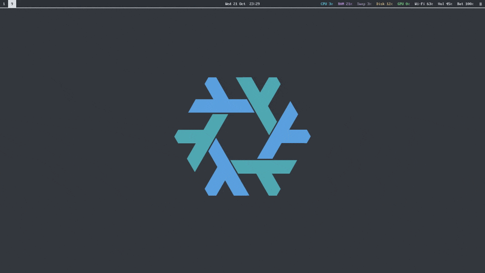
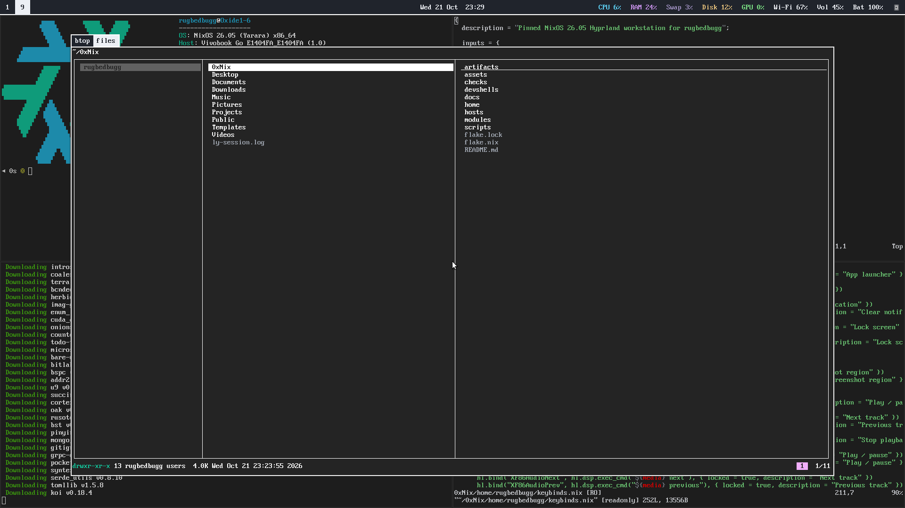

# 0xNix

NixOS Hyprland workstation flake.



<!-- Drag ~/Videos/0xNix-demo.mp4 into this spot in the GitHub web editor for the full-quality video. -->

## Screenshots

| | |
|---|---|
|  |  |
| Desktop | fastfetch, genact and two config files in vim |
|  |  |
| Fuzzel launcher | lf file manager overlay |
|  |  |
| Keybind cheatsheet (Super + /) | btop overlay (Ctrl + Shift + Esc) |
|  | |
| Wallpaper switcher (Super + Shift + W) | |

Waybar tooltips for CPU, RAM and disk:


## About

Declarative configuration for the ASUS Vivobook Go E1404FA and user `rugbedbugg`,
based on the installed NixOS 26.05 revision. Builds and checks are complete;
the tested Hyprland desktop and Home Manager are permanently installed as
generation 2, the boot default. Generation 1 remains available for rollback.
Protected Arch/EFI files and firmware boot variables matched after switching;
reboot and dual-boot testing remain pending. The original hardware module and
audit snapshots are preserved.

## Use it on your machine

1. Edit [`vars.nix`](vars.nix). It holds the username, hostname, login display name and commit author name. Every module reads these values from there.
2. Replace `hosts/nixos/hardware-configuration.nix` with your own:

   ```sh
   nixos-generate-config --show-hardware-config > hosts/nixos/hardware-configuration.nix
   ```

   `checks.configuration-safety` pins the storage and boot layout of the original machine. Update the baseline in [`checks/default.nix`](checks/default.nix) to match your hardware.
3. Create the git identity file. It stays outside the repository:

   ```sh
   mkdir -p ~/.config/git
   cat > ~/.config/git/identity <<'EOF'
   [user]
   	email = you@example.com
   	signingkey = YOUR_GPG_KEY_FINGERPRINT
   EOF
   chmod 600 ~/.config/git/identity
   ```

   Commits are signed by default. Without a GPG key, set `signByDefault = false` in [`home/rugbedbugg/git.nix`](home/rugbedbugg/git.nix). Each switch prints a warning until this file exists.
4. Stage every new or renamed file before you build. Flakes only see files tracked by git. An untracked file fails with a "path does not exist" error, even if it is on disk.
5. Build and switch:

   ```sh
   sudo nixos-rebuild switch --flake .#nixos
   ```

Keep private values such as your email out of `vars.nix`. It is committed and ends up in the world-readable Nix store. Put them in a runtime file like the git identity file instead.

## Build without activating

From this directory:

```sh
nix --extra-experimental-features 'nix-command flakes' flake check --max-jobs 2 --cores 2
nix --extra-experimental-features 'nix-command flakes' build .#system --out-link result-system --max-jobs 2 --cores 2
```

These commands write build results to the Nix store and a local result symlink.
They do not change the active system, user configuration, bootloader or EFI files.
The running configuration enables flakes. Use the explicit repository path for
future rebuilds: `/etc/nixos/configuration.nix` remains the preserved original,
and a bare `nixos-rebuild switch` would use that original configuration.
The first permanent activation is complete; do not rerun its one-time helper.
Future activations still require build/test validation and a check of any EFI writes.

## Development environments

```sh
nix --extra-experimental-features 'nix-command flakes' develop .#python
```

Available names: `default`, `python`, `go`, `bash`, `rust`, `node`, `cpp`, `systems`,
and `ai`. The experimental-feature flag is optional on the active system.
Each shell gets its packages from the same lock.
Python projects may use `uv` to maintain their own dependency lock and virtualenv.
Fish/direnv integration is configured, but each project's `.envrc` still needs
the normal explicit `direnv allow` trust decision.

## Desktop controls

| Key | Action |
|---|---|
| Super + Enter | Foot terminal |
| Super + D | Fuzzel application launcher |
| Super + B | Firefox |
| Super + Q | Close focused window |
| Super + V | Toggle floating |
| Super + arrows | Focus adjacent window |
| Super + 1…0 | Select workspace 1…10 |
| Super + Shift + 1…0 | Move window to workspace |
| Super + left/right mouse drag | Move/resize floating window |
| Super + Shift + L | Lock session |
| Super + Shift + E | End the UWSM session |

More bindings, using the plain desktop tools
([`home/rugbedbugg/keybinds.nix`](home/rugbedbugg/keybinds.nix)):

| Key | Action |
|---|---|
| Super (tap) | Fuzzel application launcher |
| Super + T / W / C | Foot / Firefox / vim in Foot |
| Super + E | Toggle the lf file manager overlay |
| Super + Shift + arrows | Move window |
| Super + L, Super + Alt + L | Lock session |
| Ctrl + Alt + Delete | Session menu: lock, logout, suspend, reboot, shutdown |
| Super + N | Show the last dismissed notification |
| Ctrl + Alt + C | Dismiss all notifications |
| Print | Screenshot the screen to the clipboard and `~/Pictures/Screenshots` |
| Super + Shift + S, Super + Shift + Alt + S | Screenshot a region |
| Ctrl + Super + Space / = / − / Backspace | Media play-pause / next / previous / stop |
| Super + Shift + M | Mute output |
| Ctrl + Alt + V | Pavucontrol |
| Ctrl + Super + Shift + R, Ctrl + Super + Alt + R | Restart waybar |
| Ctrl + Super + Shift + L | Suspend |

Volume, microphone mute and display brightness keys are configured. The session
locks after ten idle minutes and requests a lock before suspend. Runtime checks,
including successful unlock, are still required before treating this as verified.

## Updates

Review and change pins deliberately, rebuild and inspect the resulting diff.
Do not change `system.stateVersion` or `home.stateVersion` as an upgrade shortcut.
`checks.configuration-safety` deliberately rejects boot/storage changes; changing
that policy requires a deliberate baseline update in `checks/default.nix`.

Keep the generation-1 rollback path and the relevant Home Manager backups until
desktop and dual-boot validation are complete.
