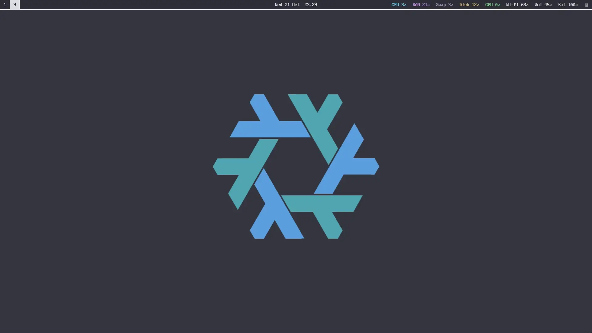
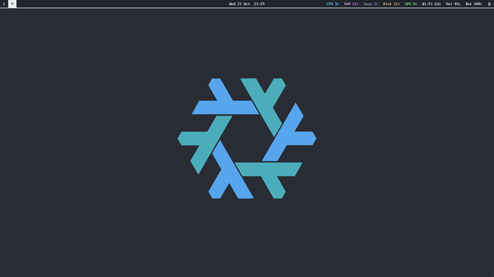
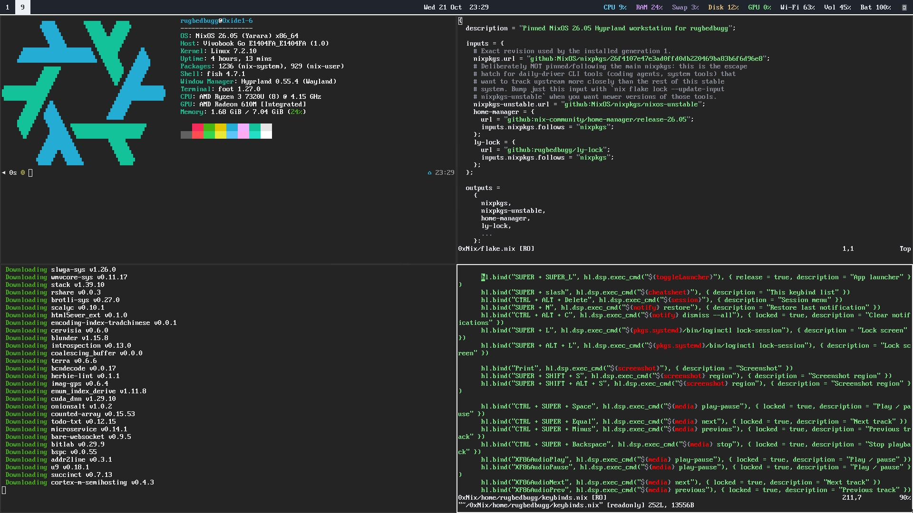
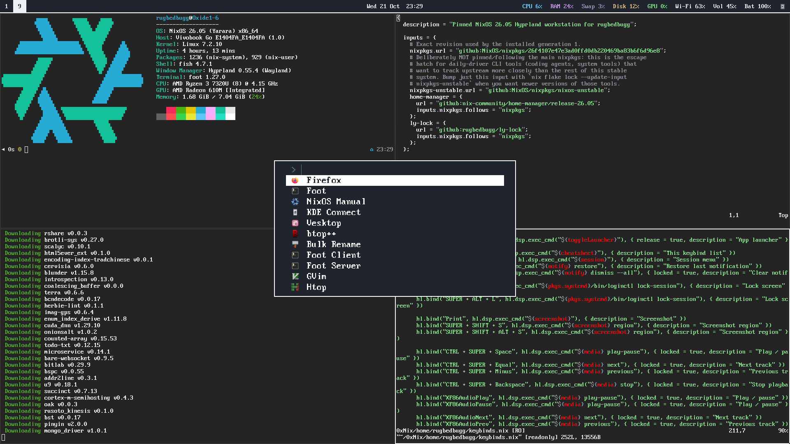
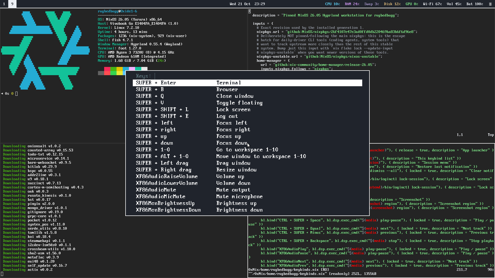
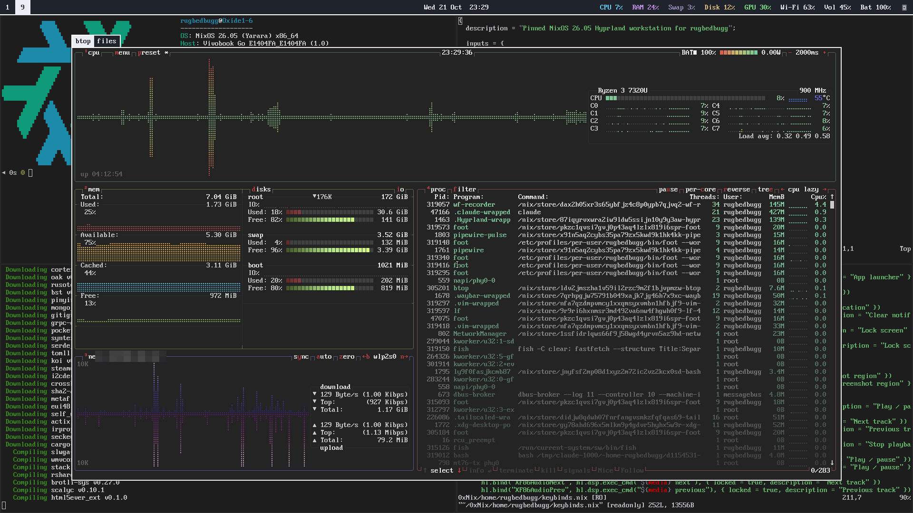
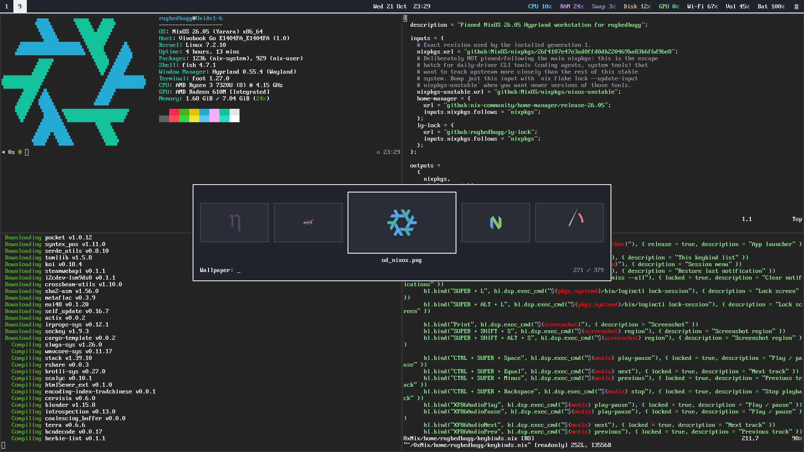
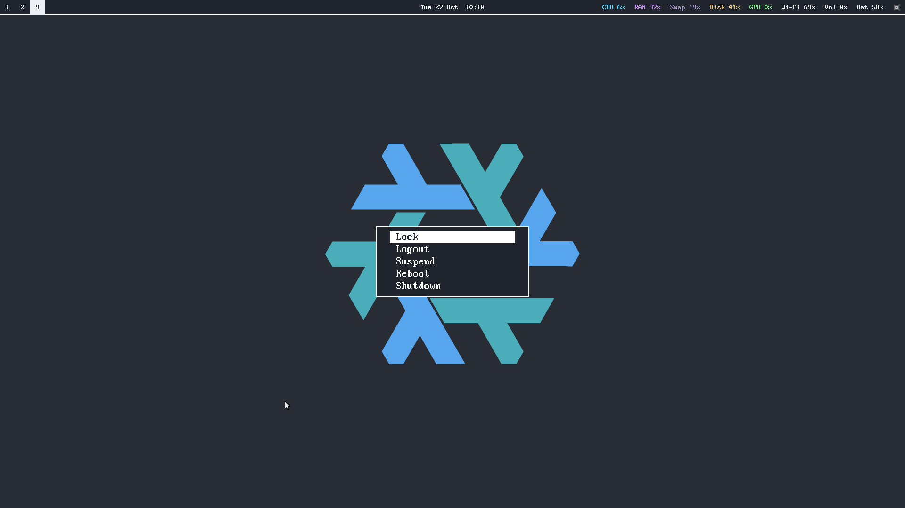
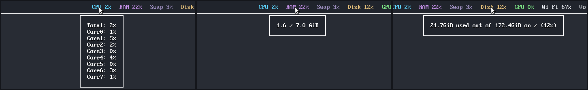

# 0xNix

TTY-themed NixOS Hyprland workstation flake



## Screenshots

| Bare Desktop | General Desktop view |
|---|---|
|  |  |  

| Fuzzel launcher | Keybind cheatsheet (Super + /) |
|---|---|
|  |  |  

| btop overlay (Ctrl + Shift + Esc) | Wallpaper switcher (Super + Shift + W) |
|---|---|
|  |  |

| Session menu (Ctrl + Alt + Delete) |
|---|
|  |


Waybar tooltips for CPU, RAM and disk:



## Use it on your machine

1. Edit [`vars.nix`](vars.nix). It holds the username, hostname, login display name, commit author name and screen resolution. Every module reads these values from there.
2. Replace `hosts/nixos/hardware-configuration.nix` with your own:

   ```sh
   nixos-generate-config --show-hardware-config > hosts/nixos/hardware-configuration.nix
   ```

   `checks.configuration-safety` pins the storage and boot layout of the original machine. Update the baseline in [`checks/default.nix`](checks/default.nix) to match your hardware.
3. Create the git identity file. It stays outside the repository:

   ```sh
   mkdir -p ~/.config/git
   cat > ~/.config/git/identity <<'EOF'
   [user]
   	email = you@example.com
   	signingkey = YOUR_GPG_KEY_FINGERPRINT
   EOF
   chmod 600 ~/.config/git/identity
   ```

   Commits are signed by default. Without a GPG key, set `signByDefault = false` in [`home/rugbedbugg/git.nix`](home/rugbedbugg/git.nix). Each switch prints a warning until this file exists.
4. Stage every new or renamed file before you build. Flakes only see files tracked by git. An untracked file fails with a "path does not exist" error, even if it is on disk.
5. Build and switch:

   ```sh
   sudo nixos-rebuild switch --flake .#nixos
   ```

Keep private values such as your email out of `vars.nix`. It is committed and ends up in the world-readable Nix store. Put them in a runtime file like the git identity file instead.

## Build without activating

From this directory:

```sh
nix --extra-experimental-features 'nix-command flakes' flake check --max-jobs 2 --cores 2
nix --extra-experimental-features 'nix-command flakes' build .#system --out-link result-system --max-jobs 2 --cores 2
```

These commands write build results to the Nix store and a local result symlink.
They do not change the active system, user configuration, bootloader or EFI files.
The running configuration enables flakes. Use the explicit repository path for
future rebuilds. The original `/etc/nixos` files are retired to
`/etc/nixos/retired-2026-10-21/`. A bare `nixos-rebuild switch` stops with an
error that points back to the flake.
The first permanent activation is complete; do not rerun its one-time helper.
Future activations still require build/test validation and a check of any EFI writes.

## Development environments

```sh
nix --extra-experimental-features 'nix-command flakes' develop .#python
```

Available names: `default`, `python`, `go`, `bash`, `rust`, `node`, `cpp`, `systems`,
and `ai`. The experimental-feature flag is optional on the active system.
Each shell gets its packages from the same lock.
Python projects may use `uv` to maintain their own dependency lock and virtualenv.
Fish/direnv integration is configured, but each project's `.envrc` still needs
the normal explicit `direnv allow` trust decision.

## Desktop controls

| Key | Action |
|---|---|
| Super + B | Microsoft Edge |
| Super + Q | Close focused window |
| Super + V | Toggle floating |
| Super + arrows | Focus adjacent window |
| Super + 1…0 | Select workspace 1…10 |
| Super + Alt + 1…0 | Move window to workspace |
| Super + left/right mouse drag | Move/resize floating window |
| Super + Shift + E | End the UWSM session |

More bindings, using the plain desktop tools
([`home/rugbedbugg/keybinds.nix`](home/rugbedbugg/keybinds.nix)):

| Key | Action |
|---|---|
| Super (tap) | Fuzzel application launcher |
| Super + T / B / C / O | Foot / Edge / vim in Foot / LibreOffice |
| Super + / | Keybind cheatsheet |
| Super + E | Toggle the lf file manager overlay |
| Super + M | Toggle the rmpc music overlay |
| Super + D | Toggle the Discord (Vesktop) overlay |
| Super + W | Toggle the WhatsApp (ZapFast) overlay |
| Super + Y | Toggle the YouTube (youtube-tui) overlay |
| Super + S | Toggle the scratch terminal overlay |
| Ctrl + Shift + Esc | Toggle the btop overlay |
| Super + Shift + W | Wallpaper switcher |
| Super + Shift + arrows | Move window |
| Super + L | Lock session |
| Ctrl + Alt + Delete | Session menu: lock, logout, suspend, reboot, shutdown. Logout, reboot and shutdown ask first. |
| Super + N | Show the last dismissed notification |
| Ctrl + Alt + C | Dismiss all notifications |
| Print | Screenshot the screen and open it in satty |
| Super + Shift + S | Screenshot a region and open it in satty |
| Ctrl + Alt + V | Pavucontrol |
| Ctrl + Super + Shift + R | Restart waybar |
| Ctrl + Super + Shift + L | Suspend |

### lf

lf runs in the Super + E overlay. It also opens for file dialogs in apps
that use the desktop portal, such as Edge and Vesktop.

| Key | Action |
|---|---|
| j / k or ↓ / ↑ | Move down / up |
| l, → or Enter | Enter a folder or open a file |
| h or ← | Go to the parent folder |
| gg / G | Jump to the top / bottom |
| Ctrl + D / Ctrl + U | Move half a page down / up |
| gh | Go to the home folder |
| . | Show or hide hidden files |
| / then n / N | Search, then jump to the next / previous match |
| f then a letter | Jump to the next name starting with that letter. ; repeats it |
| :cd path | Go to a path. Tab completes |
| Space | Mark a file and move down |
| u | Clear all marks |
| y / d / p | Copy / cut / paste |
| r | Rename |
| a | Make a folder |
| Delete | Delete, after a prompt |
| q | Quit |

In a file dialog:

- Open a file to pick it.
- Mark several with Space, then open one to pick them all.
- Go into a folder and quit to pick that folder.
- Open the suggested file to save.
- Quit without opening anything to cancel.

### satty

Screenshots open in satty. Nothing is saved or copied until you ask.

| Key | Action |
|---|---|
| c | Crop |
| z / i / r / e | Arrow / line / rectangle / ellipse |
| t | Text |
| m | Numbered marker |
| u | Blur |
| g | Highlight |
| b | Brush |
| p | Pointer |
| 1…0 | Pick a palette colour |
| Ctrl + Z / Ctrl + Y | Undo / redo |
| Ctrl + S | Save to `~/Pictures/Screenshots` |
| Ctrl + Shift + S | Save as, through the lf file dialog |
| Ctrl + C | Copy to the clipboard |
| Enter | Save and close |
| Esc | Close without saving |

Volume, microphone mute, media and display brightness keys are configured. The
session locks after ten idle minutes and requests a lock before suspend. Runtime
checks, including successful unlock, are still required before treating this as
verified.

## Updates

Review and change pins deliberately, rebuild and inspect the resulting diff.
Do not change `system.stateVersion` or `home.stateVersion` as an upgrade shortcut.
`checks.configuration-safety` deliberately rejects boot/storage changes; changing
that policy requires a deliberate baseline update in `checks/default.nix`.
